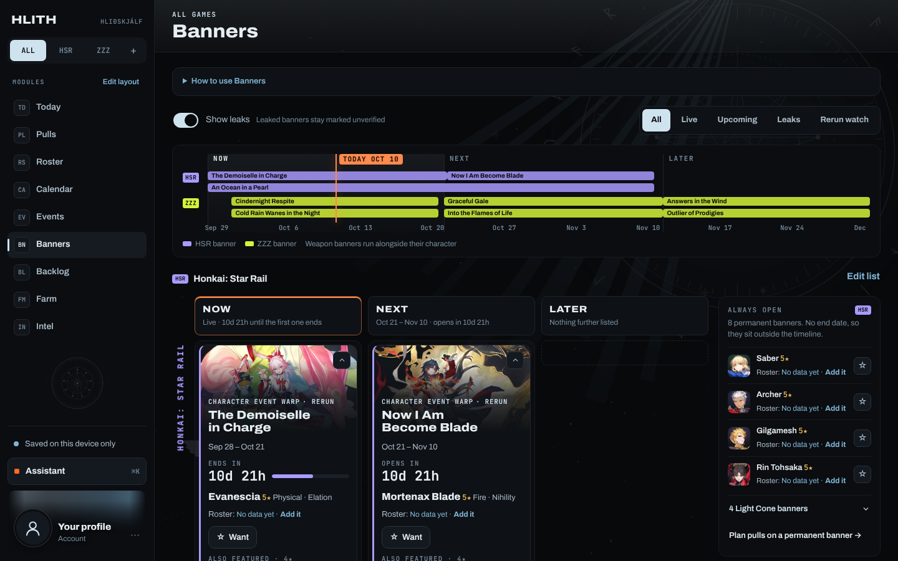
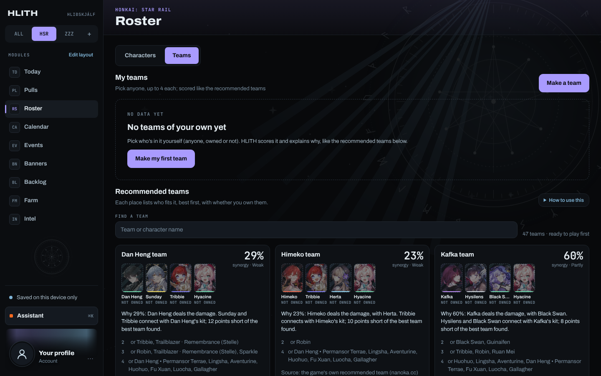
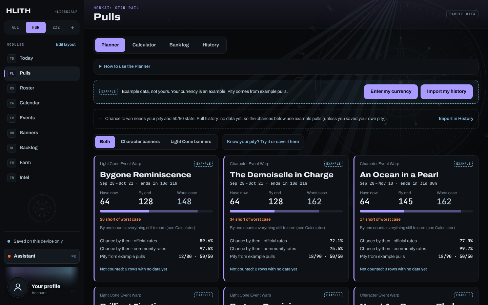
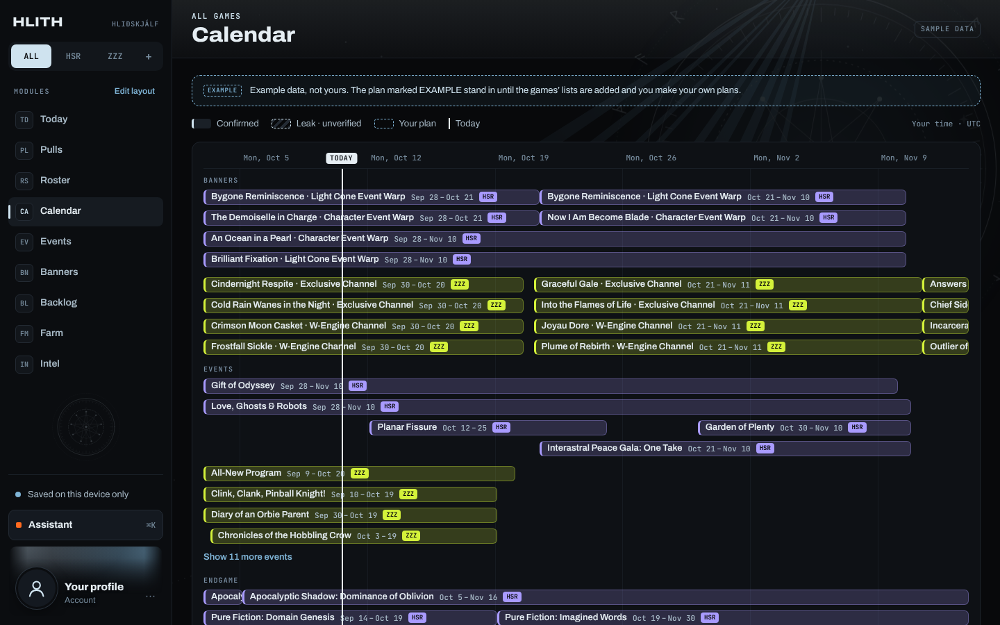
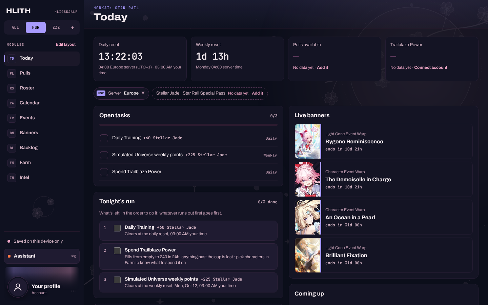
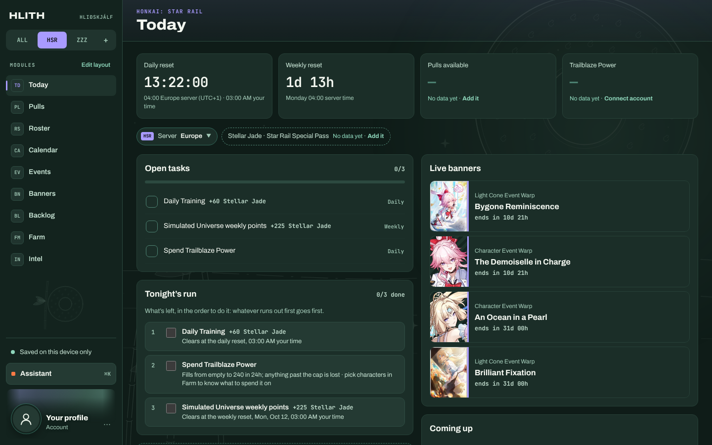
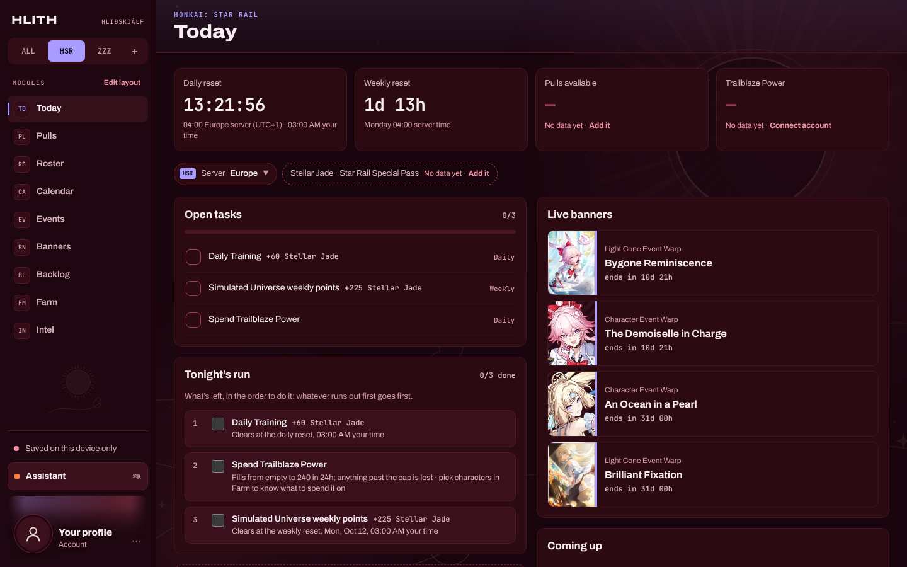
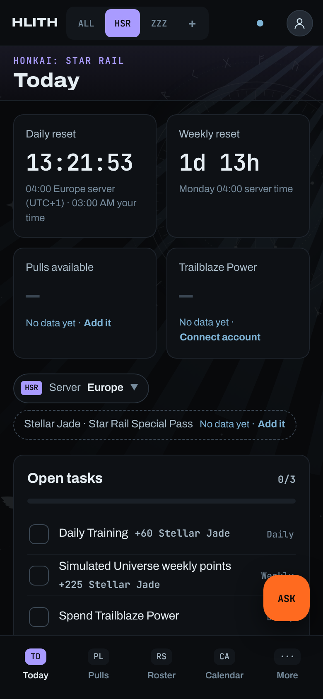
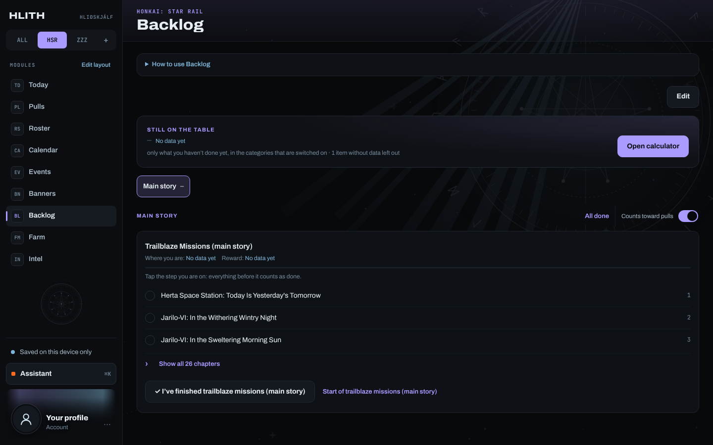

<div align="center">

# HLIÐSKJÁLF

**One seat, every world.**<br>
A command centre for your gacha games: what to do tonight, how many pulls you'll have, and who fits your teams.

[](https://project-hlith.hliskjlf.workers.dev)


Honkai: Star Rail · Zenless Zone Zero · any other game as a plug-in



</div>

---

Odin sat on Hliðskjálf and saw all nine worlds at once. **PROJECT-HLITH** does the same for
your gacha accounts: every banner, event, reset, saved pull and character you own, in one
place, on your phone and your PC.

No more five tabs, three wikis and a spreadsheet. Open it and it tells you **what to do
tonight**, **how many pulls you'll have** when the banner you want arrives, and **what's still
left to earn**.

## Highlights

| | |
|---|---|
| 🌅 **Today** | Your evening in order: dailies and weeklies on *your server's* reset, events about to end, live stamina from HoYoLAB, live banners and your wishlist. HoYoLAB ticks what it can prove. |
| 🎴 **Banners** | One timeline for every game with a TODAY line; live, next and later banners as big cards with countdowns, how each fits your account, and leaks clearly marked (or hidden). |
| 🧑‍🤝‍🧑 **Roster & Teams** | Owned, wanted, copies and saved builds. Every kit is read, so a team's synergy % explains itself in plain words, with who fits, what to pull, and team lists you can edit. |
| 🎟️ **Pulls** | Planner (chance to win, worst case), Calculator (every source until the version ends), Bank log, and History import with pity and a Luck report. |
| 🗓️ **Calendar · Events · Backlog** | Everything on one timeline, what's left in each event, and permanent content that still pays out, all counted toward your pulls. |
| ✨ **Assistant** | Ask in plain words. It proposes plans and changes; you approve or undo each one. |

<p align="center">
  
  
</p>
<p align="center">
  
  
</p>

### Make it yours

Fourteen themes, each with its own art, and every screen works on a phone.

<p align="center">
  
  
  
</p>
<p align="center">
  
  
</p>

**And around it:** sign in with Google, Discord or an email link · sync between devices ·
HoYoLAB link for live stamina, daily check-in and code redemption · pick your Trailblazer ·
a profile with picture, banner and showcase · backups you can download · an evening
message and a calendar feed · every list editable, with your own events, banners and
backlog items.

## Three promises

1. **Honest numbers.** It never shows a number it can't back up. If it doesn't know, it
   says **No data yet** and tells you how to fill it in.
2. **Your data is never wiped.** Updates to the built-in lists never touch your progress.
   Sync keeps the newer copy and stores the other one.
3. **Every game is a plug-in.** Adding a game means adding one folder. A test fails the
   build if the app ever reaches into a game's folder.

## How it's built


- **The app** is React + TypeScript, served by Cloudflare. Every merge to `main` goes live
  within minutes.
- **Supabase** holds accounts and data (each person sees only their own rows) and runs the
  server functions: HoYoLAB, history import, backups, the Assistant.
- **The scheduler** wakes every 15 minutes for the nightly backup, the HoYoLAB check-in
  and code redemption.
- **A research routine** looks for new events, banners and leaks and hands them to the
  owner to approve before anything shows up.

### Built by five AI chats

The project is written by five Claude chats that talk to each other directly and agree
before anything goes live ([how](docs/RELEASES.md)). The owner talks to MANAGER, which
sends each job where it belongs.

| Workstream | Builds |
|---|---|
| **FRAME** | The interface and base: every screen, the shell, sync, accounts. |
| **SCHEDULER** | The real game data: versions, banners, events, endgame, backlog ([brief](docs/briefs/SCHEDULER.md)). |
| **LOGIC-CORE** | The deep logic: kits, kit check, team scores, builds, materials ([brief](docs/briefs/LOGIC-CORE.md)). |
| **MANAGER** | The owner's front desk; reviews and merges every change ([brief](docs/briefs/MANAGER.md)). |
| **ERROR-FIX** | Bug fixes anywhere, when another workstream asks ([brief](docs/briefs/ERROR-FIX.md)). |

## Run it yourself

```bash
npm install
npm run dev        # the app on your machine ("this device only" mode, no sign-in needed)
npm run check      # lint + typecheck + unit tests + build
npm run e2e        # browser tests at PC and phone sizes
```

**Add a game:** copy `src/games/_template/`, fill in the contract (names, currencies,
servers, reset times, banner rules) and register it in `src/games/index.ts`. Every screen
picks it up.

```
src/
  core/      the skeleton: shell, game contract, registries, saved data, look
  tools/     the modules: Today, Pulls, Roster, Backlog, … (work for any game)
  games/     one folder per game: its contract and data
supabase/    database migrations and server functions
tests/       architecture, server and browser tests
docs/        plan, roadmap, progress, design files, workstream briefs
```

Game data from [nanoka.cc](https://nanoka.cc), used with its owner's permission. A fan
project, not affiliated with HoYoverse; game names and art belong to their owners.

## Docs

Everything is sorted in **[docs/README.md](docs/README.md)**: what it must do
([FEATURES](docs/FEATURES.md), [DESIGN](docs/DESIGN.md)), where it stands
([PROGRESS](docs/PROGRESS.md), [ROADMAP](docs/ROADMAP.md)), who builds what
([WORKSTREAMS](docs/WORKSTREAMS.md), [RELEASES](docs/RELEASES.md)) and how it runs
([SETUP](docs/SETUP.md), [DEPLOY](docs/DEPLOY.md)).
