<div align="center">

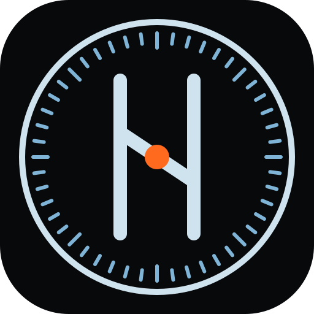

# HLIÐSKJÁLF

**One seat, every world.**

*In the old Norse stories, Hliðskjálf is Odin's high seat. From it he could look out over all
nine worlds at once.* PROJECT-HLITH is that seat for your gacha games: one place that sees
every banner, event, reset, saved pull and character you own, and tells you what to do next.

[**Open the app →**](https://project-hlith.hliskjlf.workers.dev)

[Privacy](https://project-hlith.hliskjlf.workers.dev/privacy) · [Terms](https://project-hlith.hliskjlf.workers.dev/terms) · [License](LICENSE) · [Docs](docs/README.md) · Contact: hlidskjalf.contact@gmail.com


**Honkai: Star Rail · Zenless Zone Zero** · more games on the way

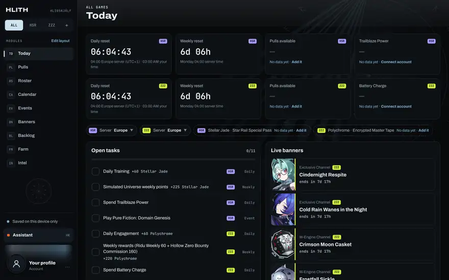

</div>

---

### Contents

[What it is](#what-it-is) · [Feature tour](#feature-tour) · [How it keeps itself current](#how-it-keeps-itself-current) · [Theorycraft](#theorycraft-for-zzz-and-hsr) · [Themes, frames and badges](#themes-frames-and-badges) · [Three promises](#three-promises) · [Ambitions](#ambitions-and-roadmap) · [How it's built](#how-its-built) · [Run it locally](#run-it-locally) · [Credits](#credits-and-contact)

## What it is

Gacha games spread what you need to know across a dozen places: the in-game mail, a wiki, a
spreadsheet, a leak channel, a calculator site, your own memory of what's still unfinished.
**HLIÐSKJÁLF pulls all of it into one seat.** Open it and it tells you:

- **what to do tonight**, in order, on your own server's reset;
- **how many pulls you'll have** when the banner you want arrives, and your chance to win it;
- **who fits your teams**, with a score that explains itself;
- **what's still left to earn** in events and permanent content.

It works on your phone and your PC, installs like an app, and opens offline with what's saved.
It never guesses: anything it can't back up says **No data yet** and tells you how to fill it in.

It is built and run by **Himeros** ([HymnToHimeros](https://github.com/HymnToHimeros)), and it
is meant to grow into the one hub you keep open for every game you play.

## Feature tour

> The pictures below are the real app. Anything marked **EXAMPLE** is the built-in example
> data you see before adding your own.

### Today: your evening, planned

Daily and weekly resets on your server's clock, live stamina from HoYoLAB, open tasks for
every game, banners about to end, and **tonight's run**: the order to do things in.

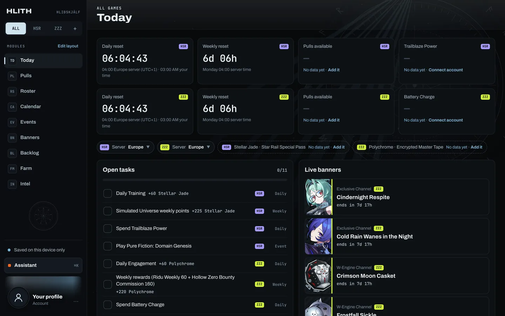

### Pulls: four tabs, one honest number

| | |
|:---:|:---:|
| 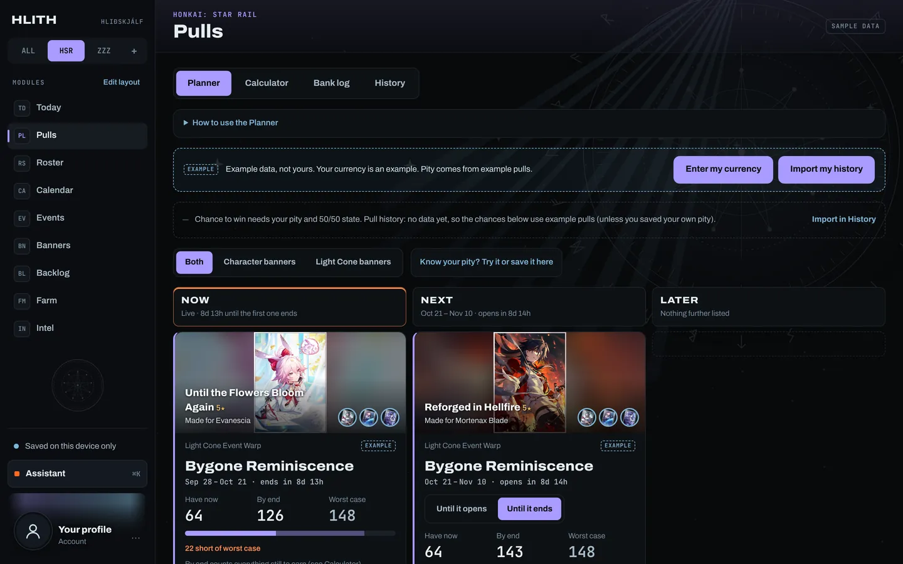 | 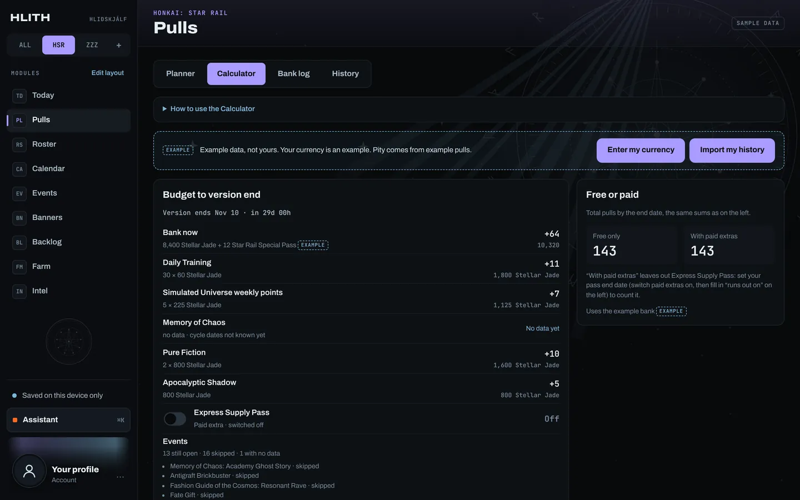 |
| **Planner:** pulls by each banner, chance to win, worst case | **Calculator:** every source counted until the version ends |
| 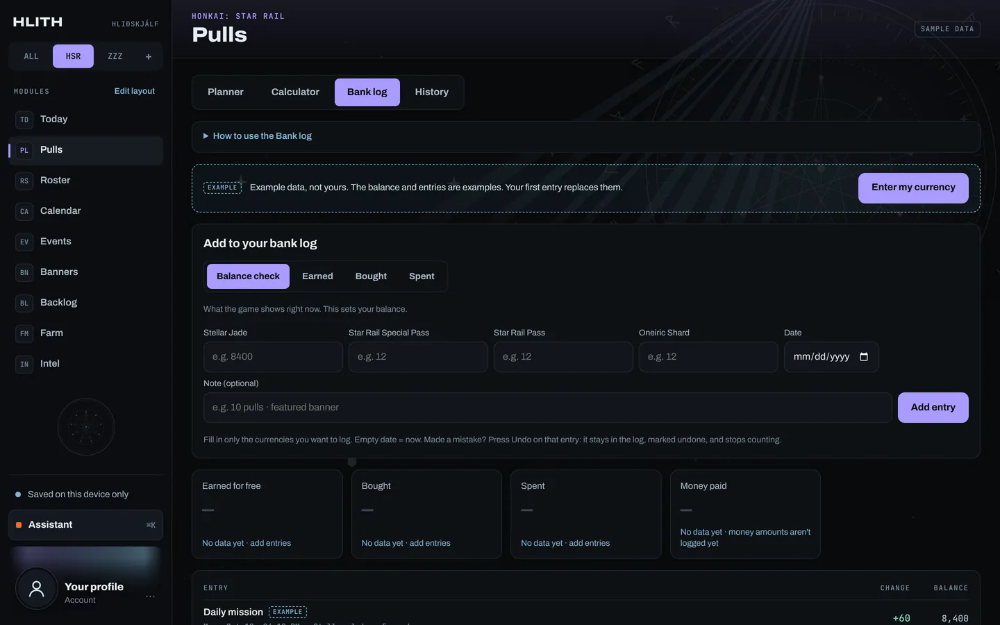 | 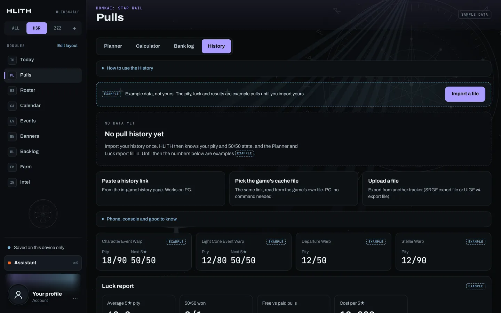 |
| **Bank log:** what you earned, bought and spent | **History:** from the in-game link or UIGF / SRGF files, with a Luck report |

### Roster, Teams and kit check

Your characters, copies and saved builds. **Recommended teams** for every damage dealer, each
with a synergy % and the reason behind it. **Kit check** shows what every skill actually does,
with the game's own text as proof.

| | |
|:---:|:---:|
| 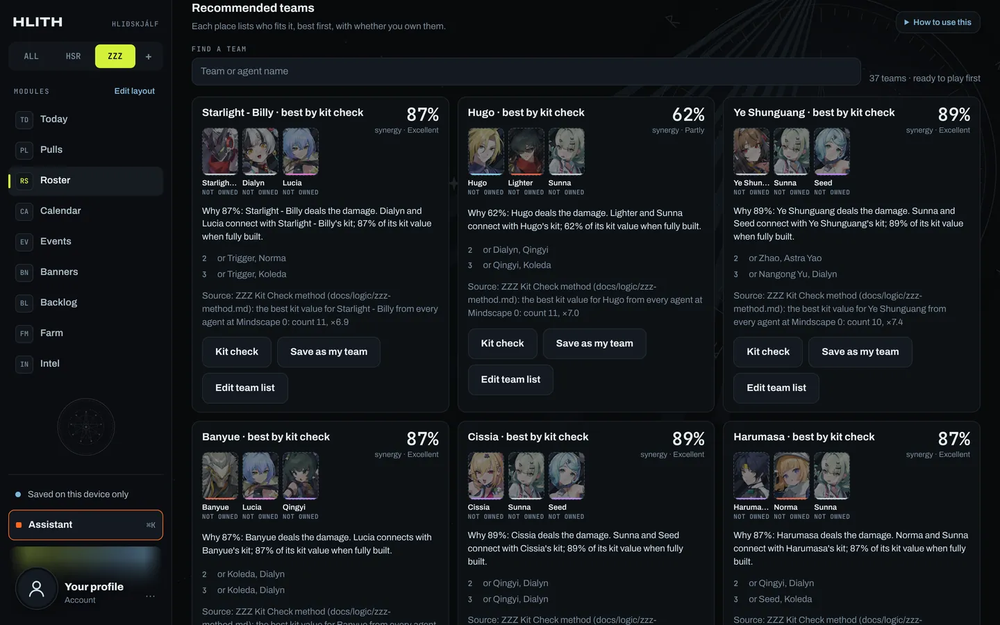 | 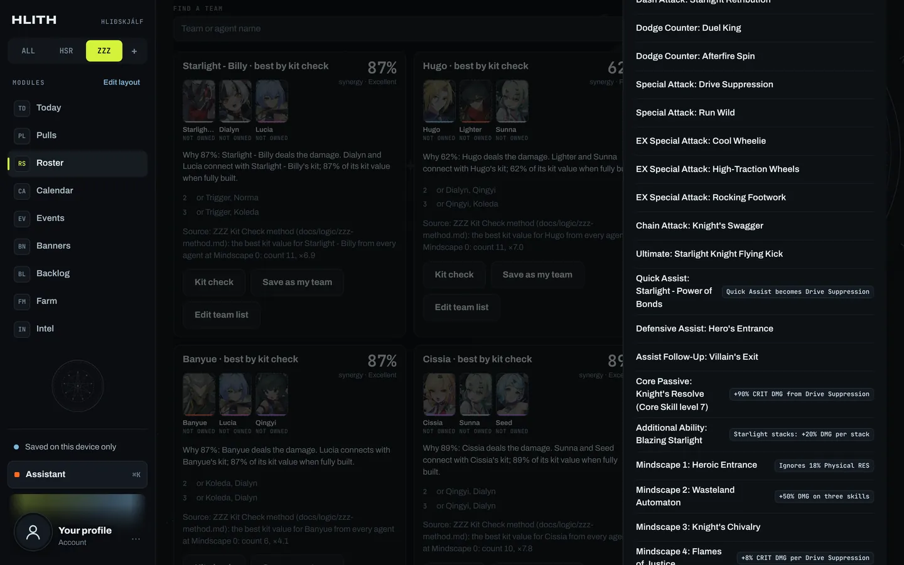 |
| **Teams:** who fits, who you own, what to pull | **Kit check:** each skill and the effect it adds |

### Banners, Calendar and Events

| | |
|:---:|:---:|
| 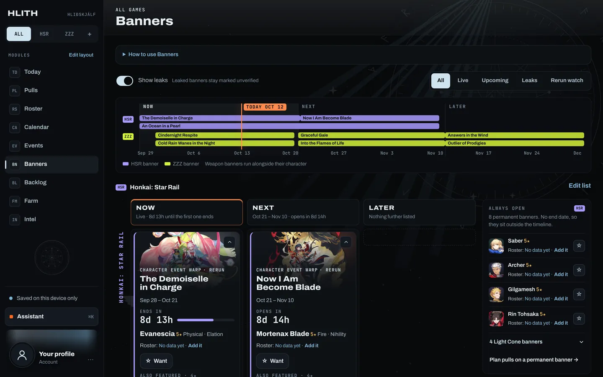 | 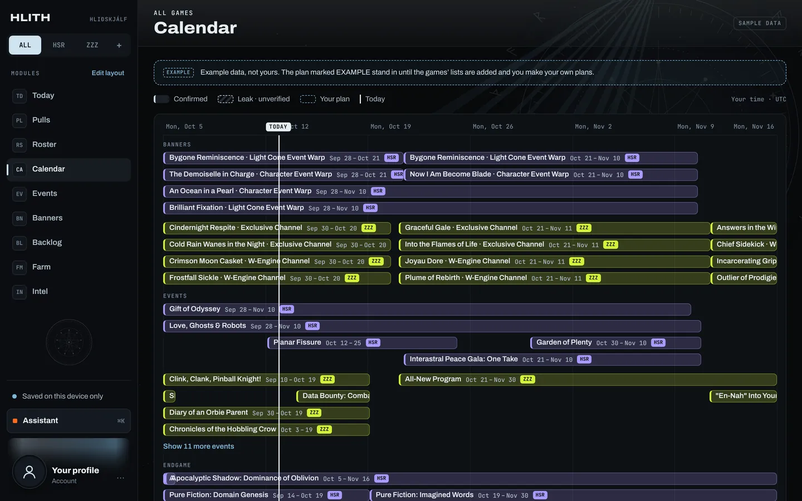 |
| **Banners:** one timeline for every game; leaks clearly marked | **Calendar:** everything on one timeline, with a calendar feed |
| 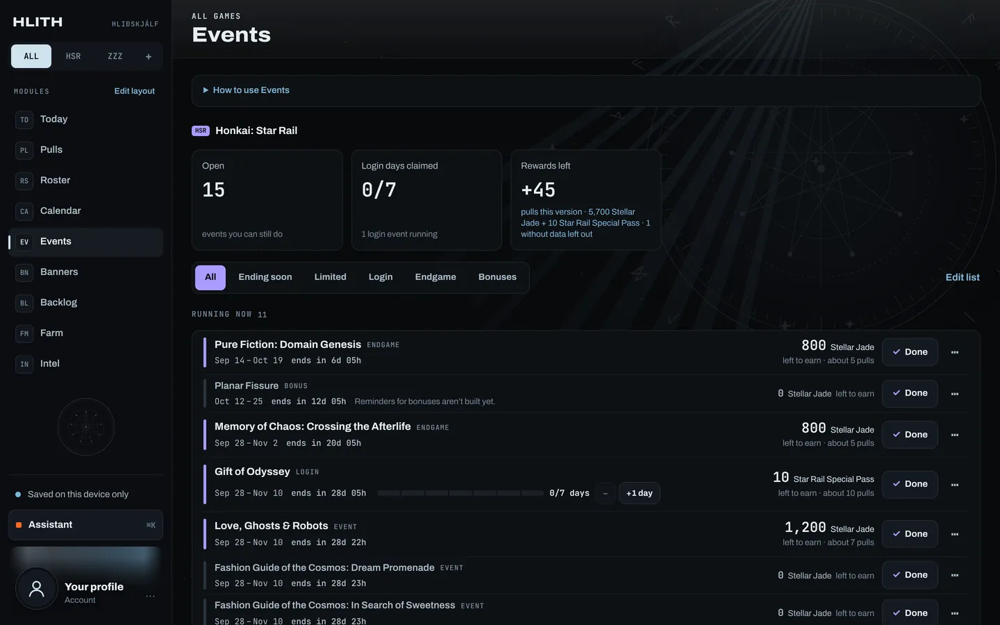 | 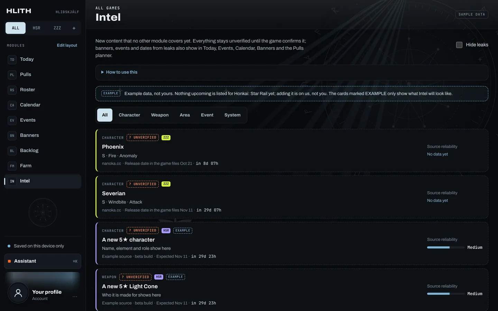 |
| **Events:** what's left in each one, and what it's worth | **Intel:** what's coming, marked unverified until the game confirms it |

### Backlog: rewards you haven't picked up yet

Permanent content that still pays out (story, exploration, achievements), counted toward
your pulls. Add your own items and **import or export** your backlog as a file.

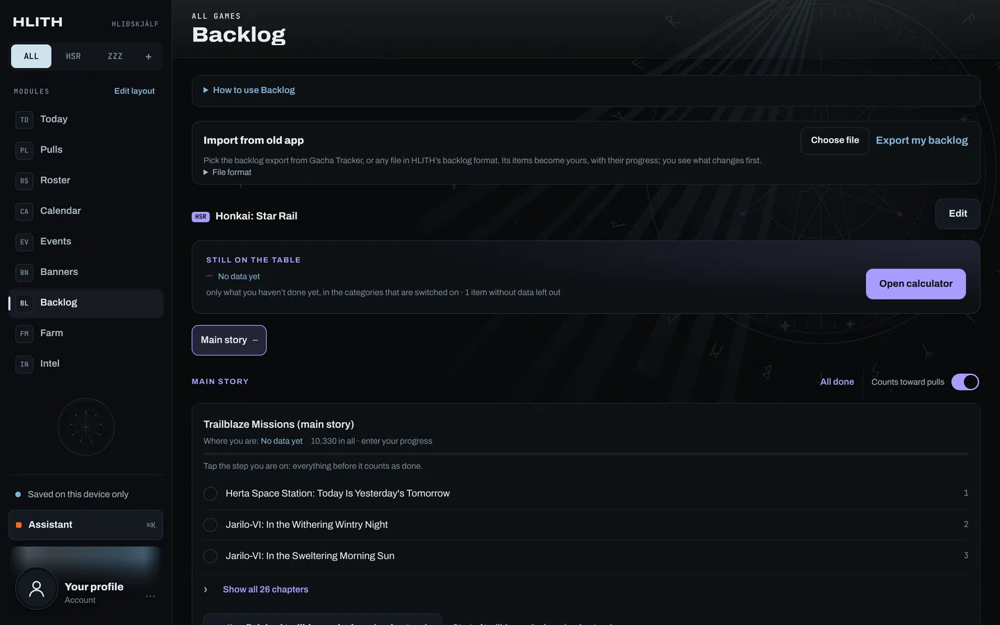

<details>
<summary><b>Backlog file format</b> (<code>hlith-backlog-export</code>, version 1)</summary>

Every row becomes one of your own items, with its progress. Importing the same file again
never adds duplicates and never lowers progress. The app has a "File format" card and a
template to download.

```json
{
  "format": "hlith-backlog-export",
  "version": 1,
  "dataAsOf": "2026-10-12T00:00:00.000Z",
  "backlog": [
    { "id": "my_chests", "game": "zzz", "category": "Exploration", "label": "Chests in a new area",
      "total": 40, "done": 12, "rewardEach": 5, "unit": "chest", "step": 1 }
  ]
}
```

Required per row: `id`, `game`, `label`, `total`. Optional: `category`, `done`, `rewardEach`,
`rewardUnknown`, `unit`, `step`, `where`, `note`.

</details>

### The Assistant: ask, then approve

Ask in plain words: "plan my session tonight", "how much can I still earn this patch?". It
reads your screens and **proposes** changes: a bank log entry, a plan, a new backlog item.
Nothing changes until you press **Approve**, and every change can be undone. You can attach
files (.json, .md, .txt, .csv, .pdf); an attached pull export or backlog file can be imported
straight from the chat.

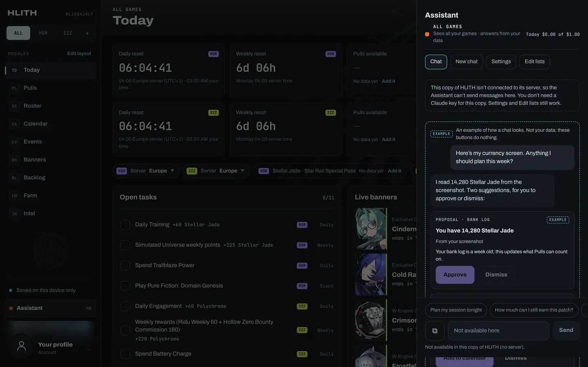

### On your phone

Every screen is built for both. Install it from the browser and it opens like an app.

<p align="center">
  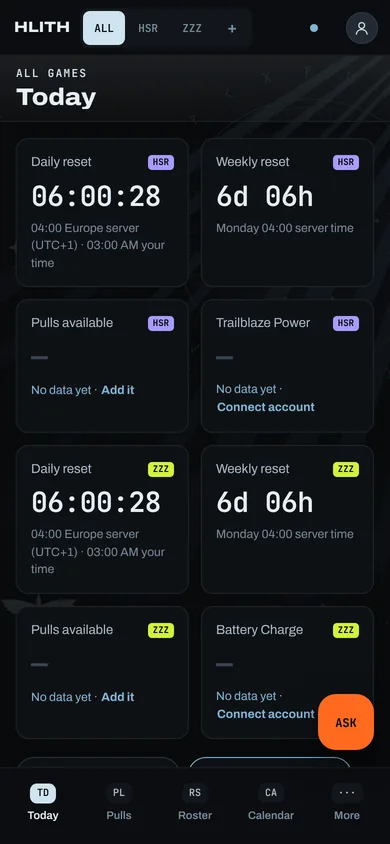
  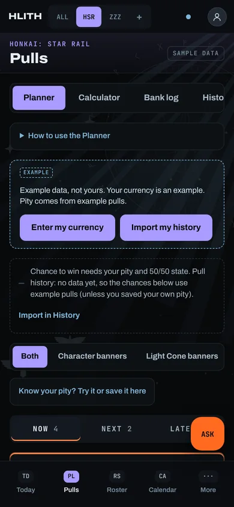
  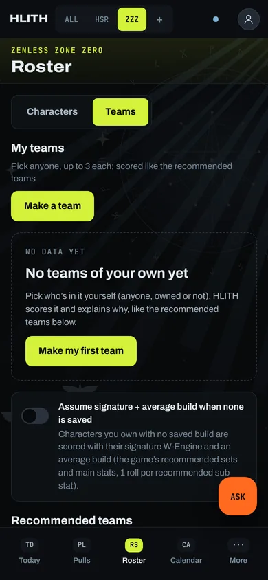
  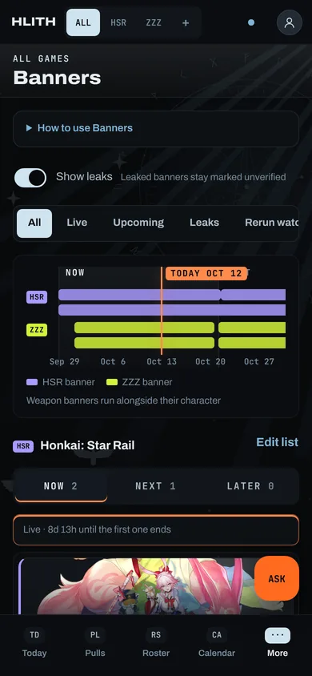
</p>

## How it keeps itself current

Game data goes stale every patch, and leaks come out in many places at once. HLIÐSKJÁLF keeps
up on its own, but **a person always has the last word**.

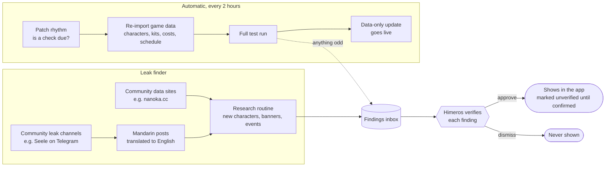

- **Automatic data refresh.** Every two hours a GitHub Action asks whether a check is due,
  counted from each game's patch day. When one is, it re-imports the lists (characters, kits,
  materials, the banner and event schedule), runs the full test suite and publishes a
  data-only update. Your own progress is never touched by it.
- **The leak finder.** A research routine reads community data sites and community leak
  channels, recognises which game a post is about, translates Mandarin posts to English, and
  skips anything the app already shows.
- **A human in the loop.** Every find lands in an inbox. **Himeros reads and verifies each one**
  before it can appear. Leaks stay clearly marked as unverified until the game confirms them,
  and you can hide them entirely.

## Theorycraft for ZZZ and HSR

Team scores in HLIÐSKJÁLF aren't tier-list opinions. Each recommended team is worked out from
the characters' kits:

- **Kit value.** Every skill, talent and passive is read from the game text and turned into
  what it adds (damage, buffs, debuffs, energy, shields), at the level you actually have.
- **Synergy %.** How much of the damage dealer's kit value a team unlocks when fully built,
  compared with their best possible partners. "87% · Excellent" comes with the sentence that
  explains it, and the source it was worked out from.
- **Kit check.** Open any team to see every skill of every member, the effect it adds, and the
  game's own wording as proof.
- **Your builds count.** Saved builds, copies and signature gear change the numbers; without a
  saved build it can assume an average one, and it tells you when it does.

The methods are written down openly in [`docs/logic/`](docs/logic): the
[ZZZ kit check method](docs/logic/zzz-method.md), [HSR theory](docs/logic/hsr-theory.md) and the
[build score](docs/logic/build-score.md).

> [!NOTE]
> **This is theory, and it is far from perfect.** Himeros works on it daily to improve and
> tighten the logic behind the core, but it's a long, hard job. Treat a score as a well-argued
> suggestion, not a verdict, and if a team plays better than its number says, trust your hands.

## Themes, frames and badges

Make it yours: many themes, each with its own art and motion, your own background, and a
layout you can rearrange.

<p align="center">
  
  
  
</p>

Your **profile card** carries a picture, a banner, a showcase, badges and earned titles.
**Rewards** are exclusive badges, frames and name styles, given out or claimed with a code.

### The owner's looks

> [!IMPORTANT]
> **Not publicly available yet.** These are Himeros's own looks, drawn for the app. Some cool
> public ones are planned.

Forty full looks across eight Norse sets, each with its own scene, card frames, sidebar art,
headings and motion:

<p align="center">
  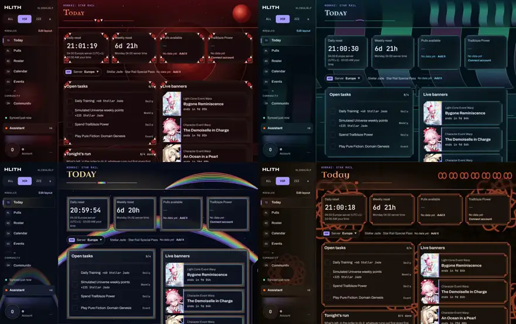
</p>

Animated badges, picture frames and name styles:

<p align="center">
  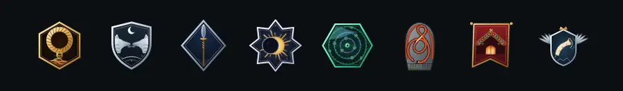<br>
  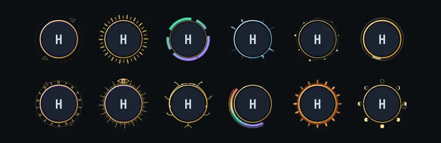<br>
  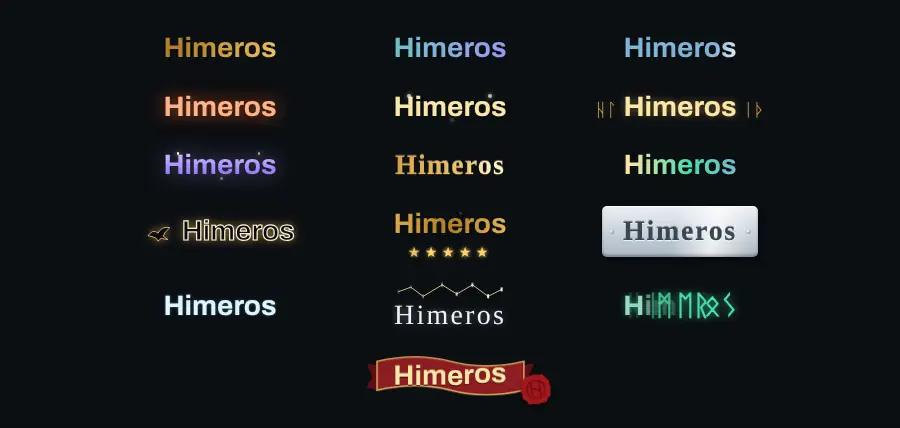
</p>

## Three promises

1. **Honest numbers.** It never shows a number it can't back up. If it doesn't know, it says
   **No data yet** and tells you how to fill it in.
2. **Your data is never wiped.** Updates to the built-in lists never touch your progress. Sync
   keeps the newer copy and stores the other one. Backups run nightly; you can download all
   your data or delete your account at any time.
3. **Every game is a plug-in.** Adding a game means adding one folder. A test fails the build
   if the app ever reaches into a game's folder.

## Ambitions and roadmap

HLIÐSKJÁLF is meant to be the seat you sit in for **every** game you play, not just two.

- **More games.** Wuthering Waves next, then Genshin Impact, then Arknights: Endfield. Each
  arrives as its own plug-in with its banners, currencies, resets and kits
  ([what it would take](docs/research/2026-10-11-new-games.md)).
- **Sharper theorycraft.** Deeper kit reading, more team shapes, and scores that learn from
  how teams actually perform.
- **Community.** Share teams and profiles, a community space, and public looks, badges and
  frames for everyone.
- **Less work for you.** More of your account read in automatically, and an Assistant that
  plans further ahead.

The live checklist ticks itself: [ROADMAP](docs/ROADMAP.md).

## How it's built

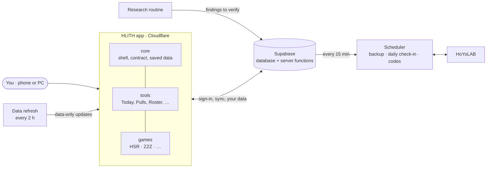

- **The app:** React 19 + TypeScript (strict) + Vite, served by Cloudflare Workers as an
  installable app with an offline shell. Every merge to `main` goes live within minutes.
- **Supabase** holds accounts and data (each person sees only their own rows) and runs the
  server functions: HoYoLAB, history import, backups, rewards, the Assistant.
- **The scheduler** wakes every 15 minutes for the nightly backup, the HoYoLAB check-in and
  code redemption.
- **Five workstreams** build it (FRAME, SCHEDULER, LOGIC-CORE, MANAGER, ERROR-FIX), each with its
  own files and brief; see [WORKSTREAMS](docs/WORKSTREAMS.md) and [RELEASES](docs/RELEASES.md).

```
src/          the app: index.html, main.tsx and
  core/         the skeleton: shell, game contract, registries, saved data, look
  tools/        the modules: Today, Pulls, Roster, Backlog, … (work for any game)
  games/        one folder per game: its contract, data and rules (+ _template/)
public/       icons and the app manifest
config/       tool settings: Vite, TypeScript, ESLint, Playwright, legal pages
supabase/     database migrations and server functions
scripts/      data imports, leak finder, app icons, roadmap
tests/        architecture, server and browser tests
docs/         plan, roadmap, progress, design files, logic, workstream briefs
```

## Run it locally

Needs Node 22 or newer.

```bash
npm install
npm run dev        # the app on your machine; works in "this device only" mode without sign-in
npm run check      # lint + typecheck + unit tests + build (what CI runs)
npm run e2e        # browser tests at PC and phone sizes (Playwright)
npm run build      # production build into dist/
npm run preview    # serve that build locally
```

For sign-in and sync, copy `config/.env.example` to `config/.env.local` and fill in your own
Supabase project URL and publishable key ([SETUP](docs/SETUP.md)).

Data scripts (re-run when a game updates): `npm run data:nanoka`, `data:kits`, `data:hsr-kits`,
`data:costs`, `data:builds`, `data:schedule`; the leak finder is `npm run leaks:seele`.
`npm run roadmap` refreshes the self-ticking [ROADMAP](docs/ROADMAP.md).

**Add a game:** copy `src/games/_template/`, fill in the contract (names, currencies, servers,
reset times, banner rules) and register it in `src/games/index.ts`. Every screen picks it up.

## Credits and contact

- Made by **Himeros** ([HymnToHimeros](https://github.com/HymnToHimeros)).
- Game data and Intel (leaks) are gathered from community data sites such as
  [nanoka.cc](https://nanoka.cc) and community leak channels, plus official game sites and
  announcements. Thank you to everyone who documents these games.
- A fan project, **not affiliated with HoYoverse**. Game names and art belong to their owners.
- Contact: **hlidskjalf.contact@gmail.com**

Every document is listed in **[docs/README.md](docs/README.md)**.

## License

© 2026 HymnToHimeros. All rights reserved. See [LICENSE](LICENSE).
The source is visible here but it is **not open source**: copying, hosting or reusing it needs
written permission. Takedown templates are in [docs/COPYRIGHT.md](docs/COPYRIGHT.md).
