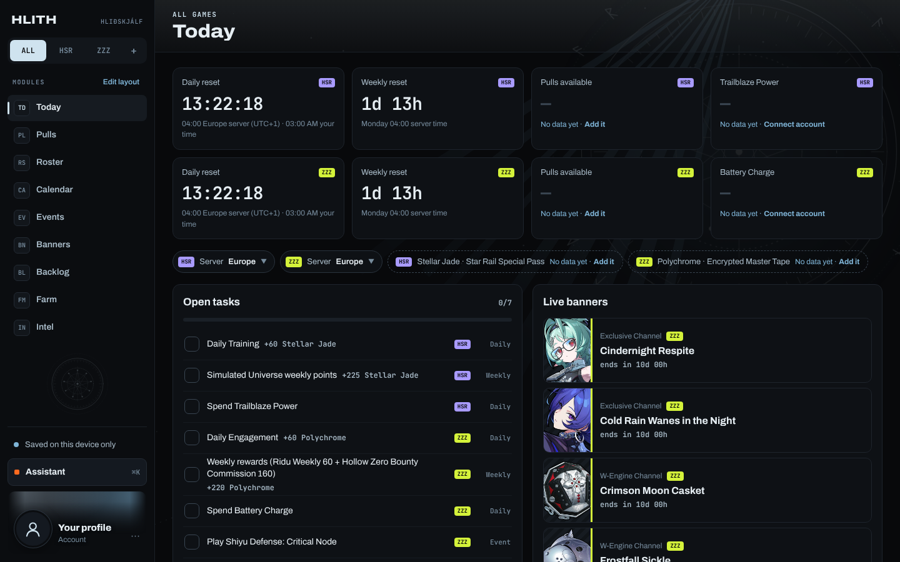
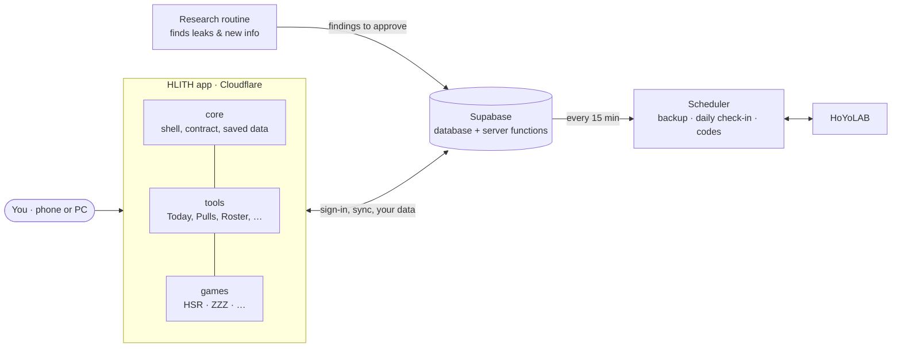

<div align="center">

# HLIÐSKJÁLF

**One seat, every world.** A command centre for your gacha games.

[**Open HLITH →**](https://project-hlith.hliskjlf.workers.dev)

Honkai: Star Rail · Zenless Zone Zero · any other game as a plug-in

</div>

---

Odin sat on Hliðskjálf and saw all nine worlds at once. HLITH does the same for your
gacha accounts: every banner, every event, every reset, every pull you have saved and
every character you own, in one place, on your phone and your PC.

No more five tabs, three wikis and a spreadsheet. Open HLITH and it tells you **what to
do tonight**, **how many pulls you'll have** when the banner you want arrives, and
**what's still left to earn**.

<p align="center">
  
</p>

## What it does

| | |
|---|---|
| 🌅 **Today** | Your evening in order: dailies and weeklies that reset at *your server's* reset, events about to end, stamina, live banners, and a wishlist of banners for characters you want. Tick things off; ticks reset by themselves. |
| 🎟️ **Pulls** | **Planner** (pulls by each banner, chance to win, worst case) · **Calculator** (every source of currency until the version ends) · **Bank log** (what you have, earned, bought, spent) · **History** (import your real pulls → pity, 50/50 state and a Luck report). |
| 🗓️ **Calendar** | Banners, events, endgame resets and your own plans on one timeline, with a link to put it in your phone's calendar. |
| 🎪 **Events** | What's running, what you've done or skipped, login days claimed, and how much currency is still on the table. |
| 📚 **Backlog** | Permanent content that still pays out: tap where you are in the story, tick side quests, count up modes and achievements. Switch a category on and it counts toward your pulls. |
| 🎴 **Banners** | Live and upcoming banners, leaks (clearly marked, and hideable), and how each one fits your account. |
| 🧑‍🤝‍🧑 **Roster** | Every character: owned, wanted, copies. Character pages, your own teams, recommended teams, share a team with a link, and a kit check. |
| 🌾 **Farm** | Pick who you're building; see the materials, the stamina and the days it takes. |
| 🔭 **Intel** | New content no other screen covers yet, always marked unverified. |
| ✨ **Assistant** | Ask in plain words. It can propose plans and changes, and you approve or undo each one. |

**And around it:** sign in with Google, Discord or an email link · everything syncs
between your devices · HoYoLAB link for live stamina, automatic daily check-in and code
redemption, for several accounts at once · a profile page with picture, banner, bio and
showcase · backups you can download · an evening message and a calendar feed.

## Yours to change

Anything you personalise, you control. Every list has an **Edit** button: change any
entry, add your own events, banners and backlog items, or hide what you don't need.
Nothing is ever deleted behind your back; hidden things come back with one tap, and
changes can be undone.

While the game lists are still being filled, screens show **examples** with an
`EXAMPLE` badge, so you can see how everything works. They're never counted in your
numbers. Change an example and it becomes yours, or switch all examples off in
*Account → Example data*.

## Three promises

1. **Honest numbers.** HLITH never shows a number it can't back up. If it doesn't know,
   it says **No data yet** and tells you how to fill it in.
2. **Your data is never wiped.** Updates to the built-in lists never touch your
   progress. Sync keeps the newer copy and stores the other one, never throws it away.
3. **Every game is a plug-in.** Adding a game means adding one folder. The app itself
   never changes for it, and a test fails the build if it ever tries to.

## How it fits together



- **The app** is React + TypeScript, served by Cloudflare. Every merge to `main` goes
  live within minutes.
- **Supabase** holds accounts and data (each person sees only their own rows), and
  runs the server functions: HoYoLAB, history import, backups, the Assistant.
- **The scheduler** wakes every 15 minutes and runs what's due: the nightly backup,
  the HoYoLAB daily check-in and code redemption.
- **A research routine** looks for new events, banners and leaks and hands them to the
  owner to approve before anything shows up.

## Who builds what

HLITH is built by several focused workstreams, each with its own brief:

| Workstream | Builds |
|---|---|
| **FRAME** | The whole interface and base: every screen, the shell, sync, accounts, scheduler. |
| **SCHEDULER** | The real game data: versions, banners, events, endgame, backlog ([brief](docs/briefs/SCHEDULER.md)). |
| **LOGIC-CORE** | The deep logic: kits, kit check, team scores, builds, materials ([brief](docs/briefs/LOGIC-CORE.md)). |

## For developers

```bash
npm install
npm run dev        # the app on your machine ("this device only" mode, no sign-in needed)
npm run check      # lint + typecheck + unit tests + build: run before every commit
npm run e2e        # browser tests at PC and phone sizes
npm run roadmap    # refresh the self-ticking roadmap
```

**Add a game:** copy `src/games/_template/`, fill in the contract (names, currencies,
servers, reset times, banner rules), register it in `src/games/index.ts`. Every screen
picks it up.

```
src/
  core/      the skeleton: shell, game contract, registries, saved data, look
  tools/     the modules: Today, Pulls, Roster, Backlog, … (work for any game)
  games/     one folder per game: its contract and data
supabase/    database migrations and server functions
tests/       architecture, server and browser tests
docs/        plan, roadmap, progress, design files, workstream briefs
```

React 19 · Vite · TypeScript (strict) · CSS Modules · Supabase · Cloudflare Workers ·
Vitest · Playwright. Game data from [nanoka.cc](https://nanoka.cc), used with its owner's
permission.

## Docs

| | |
|---|---|
| [FEATURES](docs/FEATURES.md) | Everything HLITH must do |
| [ROADMAP](docs/ROADMAP.md) | What's done (ticks itself from the code) |
| [PROGRESS](docs/PROGRESS.md) | Latest work and what's next |
| [DESIGN](docs/DESIGN.md) · [design files](docs/design) | How it looks |
| [WORKSTREAMS](docs/WORKSTREAMS.md) | Who builds what |
| [SETUP](docs/SETUP.md) · [DEPLOY](docs/DEPLOY.md) | Outside settings and hosting |
| [ROUTINES](docs/ROUTINES.md) | How the research routine delivers findings |
